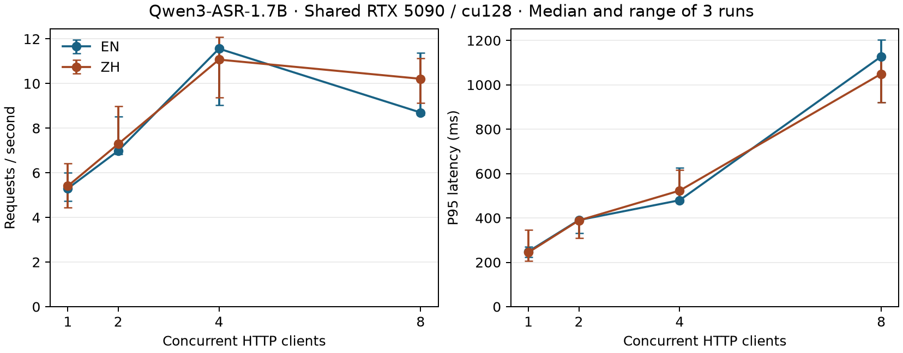

# Qwen3-ASR-1.7B BF16 on one RTX 5090 with CUDA 12.8

Tested serving source: `9cfc9e5dbfef072b770f97ae1c7ea37800202698`. Driver 570.172.08; PyTorch 2.9.1+cu128; SGLang 0.5.8; FlashInfer 0.6.1. Linux, Intel Core Ultra 9 285K. One shared 32 GB desktop GPU; this is not an exclusive-GPU benchmark.

All 40,404 measured requests were accounted for; 0 request errors. Warmups excluded. The fixed-language sweep ran 37,296 requests in 24 cells. One additional mixed-language pass ran 3,108 requests.

| Split | Clients | Requests/s: median (range) | P95 ms: median (range) | Corpus WER (EN) / CER (ZH), range |
| --- | ---: | ---: | ---: | ---: |
| EN | 1 | 5.30 (4.74-6.00) | 249 (224-270) | 1.286-1.430% |
| EN | 2 | 6.99 (6.84-8.51) | 390 (332-395) | 1.286-1.438% |
| EN | 4 | 11.56 (9.04-11.63) | 480 (475-627) | 1.279-1.415% |
| EN | 8 | 8.70 (8.59-11.37) | 1128 (921-1203) | 1.264-1.400% |
| ZH | 1 | 5.41 (4.44-6.42) | 245 (207-346) | 0.680-0.734% |
| ZH | 2 | 7.29 (7.23-8.98) | 389 (310-393) | 0.701-0.722% |
| ZH | 4 | 11.07 (9.36-12.07) | 523 (470-616) | 0.689-1.067% |
| ZH | 8 | 10.21 (9.13-11.14) | 1050 (921-1131) | 0.695-0.770% |

Without language hints (mixed order, four clients, single pass): 3103/3108 language labels matched the split (99.84%); English WER 1.370%, Mandarin CER 0.824%.

## What was measured

- SeedTTS revision `27f4c1adee83b5b29b7c4b375f6b976324bda308`: all 1,088 EN rows and 2,020 ZH rows. These reference recordings have 666 and 1010 distinct byte hashes, respectively. All rows have equal standing; the corpus error rate is weighted by reference length. Ground truth is ref_text for ref_audio, not the TTS target text.
- Closed-loop HTTP on localhost, real multipart uploads; clients reuse connections. Warm 2 x client concurrency per cell; deterministic shuffled order per repeat. Explicit language hints for the sweep; different concurrency order in each round. BF16, FlashInfer decoder, Triton audio attention, CUDA Graph up to batch 4, torch.compile off, 4 resident requests, 4,096 static KV tokens, mem_fraction_static=0.65. Eight clients exercise queueing above the resident limit. Default cache policy retained.
- English uses the repository's Whisper English normalizer and word edit distance; Chinese uses its character normalizer. Failed requests are scored as empty hypotheses. Latency starts at HTTP submission and includes queueing and response transfer. Full per-run throughput, mean/P50/P95/P99 latency, RTF, error and unit counts are in metrics.csv. Per-request IDs and transcripts are retained as compressed JSONL without audio bytes.
- Measured span 87.9 minutes. NVML sampled about every two seconds: ASR descendants peaked at 6196 MiB, minimum free 16517 MiB; unrelated compute processes occupied 7172-9168 MiB. Startup with pre-existing kernel caches: 21.5 seconds (one launch). CPU and GPU are shared; power/utilization are board-wide.
- Shutdown: listener closed=True; remaining service GPU PIDs=[].
- Dataset bytes: 701,857,722 (669.3 MiB); one model and one corpus copy, about 5.1 GiB total transient inputs. Reserve 8 GiB in addition to the existing environment.

## Limits

This qualifies this short-form EN/ZH ASR workload and the stated admission cap. It does not establish long-audio correctness, streaming behavior, TTS quality, FP8 throughput, or absence of regressions versus another software revision. It is not an A/B test against CUDA 13. Upstream issue [#1212](https://github.com/sgl-project/sglang-omni/issues/1212) used a different runtime, host and admission limit. Automatic language detection received one mixed pass, not the three-repeat sweep. No model weights or recordings are redistributed here.
